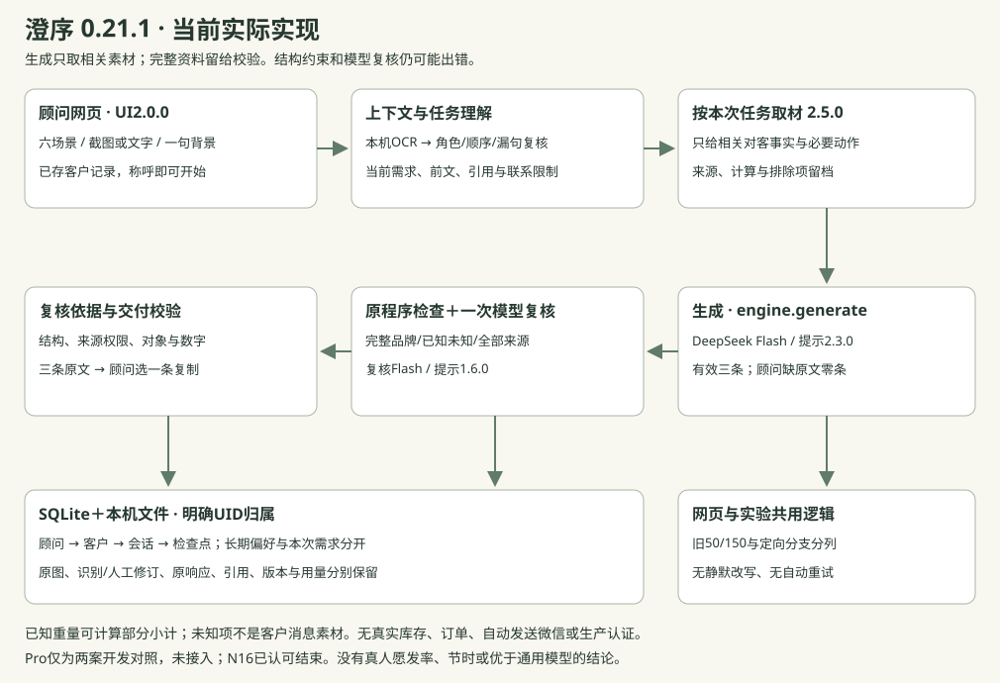

# B · 为客户顾问设计，而非只做参数答疑

当前实现0.21.1，界面UI2.0.0。目标用户是精品皮具客户顾问：既回答咨询，也推荐商品、购后关怀、生日节日问候、唤回和活动邀请。目标是复用聊天及客户记录、减少整理、给出三条可选择的中文微信。没有真人研究证明使用意愿、总节时或文案优于通用模型。

## 题目要求与自定选择

| 题目明确要求 | 本项目自行选择 |
| --- | --- |
| 虚构奢侈品牌、说明假设 | 澄序：低调、重视日常使用；托特18800、肩包12800、卡夹2800元；政策为虚构设定，不代表行业通则 |
| 六场景；客户、场景、聊天和适用商品输入；三条中文微信 | 单页本机工具，有效生成恰好三条；缺当前必需原文时请顾问补、不给客户消息，不强行凑三条 |
| work log、方法论、八列50例、带截图评估、缺陷与版本 | 原50/150、原始状态和失败不覆盖；后续定向修订、离线重验另存 |
| 源码、演示或录屏可选；架构图为加分 | 附当前源码、保存结果回放、实际架构；公网部署不是必做要求 |

OCR、截图角色草稿/补漏、SQLite检查点、来源索引、严格结构、一次模型复核、长期拒收营销，都是自定的产品取舍。避免扩成完整客户管理系统：称呼即可开工，详细依据和历史按需展开，无新必经tab。

## 实际工作流程与边界

顾问选择/新建客户→选任务→放截图或聊天→扫一眼系统理解→必要时补一句线下背景→生成→选一条复制，顾问自行发送。截图来自顾问微信时右顾问左客户只是初始假设，可改文字、角色、顺序并人工补录，原图与修订版本保留；不读出的内容不编，语音未转写不当已听过。工具缺正文请顾问处理；客户确实没提供影响当前回答的需求，才可向客户简短澄清。

信息够不够按当前任务判断：报价不用预算；容量就回答容量；已有用途与偏好可以推荐；生日可以没有客户新来信。长期偏好和拒收营销归客户，本次预算/暂缓/换款归会话；明确UID恢复，不按名字借别人的资料。单机SQLite/文件和前端恢复副本保存检查点及历史，这不是生产多租户认证。

与通用模型相比，有证据的增量主要是上下文保存恢复、可对照截图、来源记录、联系限制和版本可追溯；没有证据证明文案普遍更好。简单问题可能顾问自己答更快，长聊天和政策解释的实际总用时尚未由真人验证。

## 当前架构与模型输入

Python标准库后台、原生网页、SQLite/文件，Pillow与macOS Swift Vision本机OCR；网页和实验共用engine.generate。正常生成与复核均为deepseek-flash，生成提示2.3.0、复核1.6.0、取材2.5.0、输出约定0.11.0、品牌v0.4。替代Pro只做过固定两案对照，没有接入。

系统先利用当前消息、必要前文、角色/引用/时间、长期联系限制与需求转向形成任务，再选择相关对客事实。例如J02只给手机钥匙容量、品牌售价和小尺寸压印标识。真实请求不再重复附整本规则、全部商品/unknown或全来源目录；schema也只用同一精简任务。内部未知、权限和审核口径保存在internal_validation及完整来源中，不直接当客户素材。

明确500毫升水时，程序按约1g/mL计算水约500克，与空包750克两项约1.25公斤，瓶子、资料另加，保存算法、原背景与商品来源。没有明确水量不套用500克。普通日常判断可以结合使用情境，不要求每句有实测；相关试背和服务收尾允许，三条备选出现同一合理建议不构成失败。

完整品牌、已知/未知资料和全部来源仍交程序与原一次模型复核。客户报价不授权品牌价格，客户原话不授权折扣；引用编号存在还要核对对象、来源类别、权限和结论。复核本身也可能误判，开发者逐句阅读单列，不用pass替代事实和编辑判断。错价格/重量、虚构权益或库存、无条件舒适保证、泄露内部备注、违反明确拒绝仍要拦；轻微重复、略书面或可省建议用polish。

供应商严格工具输出不是永远合规的保证。只兼容已定义的窄情况：三条旁唯一空内部字段、合法但无业务效力的target_index元数据、当次唯一指定sources-v4而只缺协议常量；保留原响应与不合规标记，之后完整检查。不会补判定、候选、事实、引用或错误协议，不截前三条，不自动重试，不静默改写原文。单条修改范围只由用户请求决定。

## 测试设计与评估尺度

主表保留N01—N50业务集：8问候、14推荐、8购后、6唤回、7活动、7价格异议。先写自然业务输入和检查依据，再冻结；早期F集、十四挑战案与已见16案是历史开发材料。生日更正已废弃，不重新进入当前演示。

原50首四生成0.15.1、余46为0.15.2。50组150条真实原文完整保留；初始34组程序交付，0.15.3统一离线重验35组，仅N30状态改变。这是历史程序状态，不是事实正确率，也不是当前0.21.1新成绩。之后各轮按目的、上限、版本和用量另存，不能拼最好结果。

评价分开看：程序交付/误拦、事实和业务任务、复核误判、非阻断编辑。严重错价/折扣/售后承诺、内部泄露与违反拒绝，业务影响高于多说一句、轻微书面或分类。日常判断不因没有实测一律定错，必要否定和处理建议不等于防守性写作。每句话是否帮助当前问题、删掉是否仍完整，是编辑依据；三条不强制分别追问/试背/免责。

保存恢复、截图复核和来源可追溯已有本机走查证据，真实文案仍有内部口径及多余展开残留。J01/Pro新表达暴露数量主语误拦，未在模型对照后继续改规则。未知手机型号、复杂OCR和完整中文语义证明都有限制。完整材料与当前源码一致，不把未验证的愿发率、节时和生产可用写成结论。
