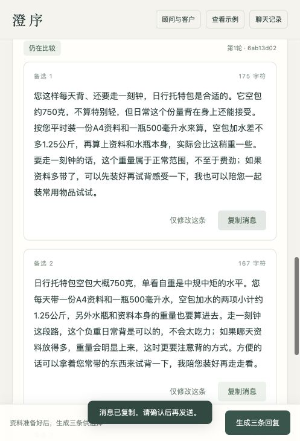
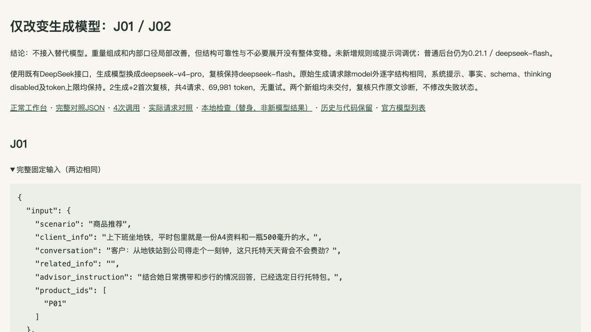
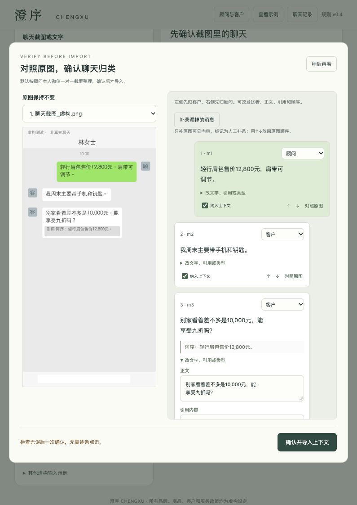

# D · 评估：交付、事实、编辑与复核分别看

当前工具0.21.1。本轮只做打包、干净解压与运行检查，模型调用0，未重跑五十例。旧结果没有变成当前模型的新结果。

## 正式50例保留原样

[完整150条原文](C_50_ORIGINALS.html) · [规定八列Excel](C_50_ORIGINALS.xlsx) · [CSV](C_50_ORIGINALS.csv)。首四0.15.1、余46为0.15.2；初始34组交付、0.15.3统一离线35组，只是程序状态。原输入、原输出、原评分与失败不删；不是当前事实正确率。Excel的状态/评读附页与八列原表分别保留。

[原50评估与逐案依据](appendix/v0.19.0/history_v0.16.3/D_EVALUATION.html) · [原始阶段与重验](appendix/v0.19.0/history_v0.16.3/STAGES.html)。后续较好候选不替换原150条，已见开发案例不装作盲测。

## 后续有目的的修复证据

| 分支 | 程序与原复核 | 独立阅读及当前结论 |
| --- | --- | --- |
| N16 | 0.19原三条；0.20补有效复核后交付 | 普通负重判断、相关试背已认可，结束，不再生成。旧无效复核留历史 |
| J01 Flash | 0.21首轮被误拦；同三条同复核在0.21.1离线交付 | 前两条组成清楚，第三条“这两项加上空包”指代不清，编辑限制仍保留 |
| J02 Flash | 0.21真实success/pass | 相关容量、品牌价和小标识均选入；第三条“不高报也不打折操作”仍是内部自述，不能因pass称全可直发 |
| J01 Pro | 原生三条合规；程序数量误拦，首次诊断needs_review | 组成较清楚；第三条被截成单独水重是程序错误。“完全”口气偏满可润色；复核把未提供写成不存在的理由不准确 |
| J02 Pro | messages数组结构不合规；首次诊断pass，仍未交付 | 内部口径消失，但仍有买单、另找别款、再考虑等展开。不能据两案宣布更稳，未接入 |

[0.20原文与尺度校正](appendix/v0.20.0/index.html) · [0.21素材/原文/离线重验](appendix/v0.21.0-0.21.1/index.html) · [完整模型并排对照](appendix/model-comparison/index.html)。每轮call ledger保留目的、模型、版本、用量和原响应。Pro的两次复核是对保存文本的首次诊断，没有将被拦结果洗成success。

## 产品与评估截图

上图为0.21.1实际页面恢复J01保存结果；不是现场重新生成。可复制不等于三个候选都获人工编辑认可。

上图为真实对照报告截图，包含失败与独立意见；不是开发AI聊天截图。

上图为0.17工作台恢复时的实际截图复核证据，UI2.0.0沿用，明确为历史实测，不冒称本轮重新识别。正常首用、切换刷新、草稿/背景恢复已有走查；本轮干净启动与回放校验单列PACKAGING_CHECK，不用本地检查数量替代产品质量。

没有真人顾问愿发率、端到端节时或相对通用模型文案优势的结论。已做的是开发者模拟走查和逐句编辑评读；不同来源的判断可能不一致，有争议用原句说明。

## 连续演示补充

原静态截图回放按用户要求撤下。当前[连续演示](DEMO.html)实际生成/复核各一次，三条模型原文见continuous_demo/REAL_RUN.json；选第三条复制，刷新恢复。此2请求与原打包的0请求分列，不替换正式50成绩。第一条多余追问记编辑问题，不调提示重抽。视频停顿加速，不作为节时证据。
