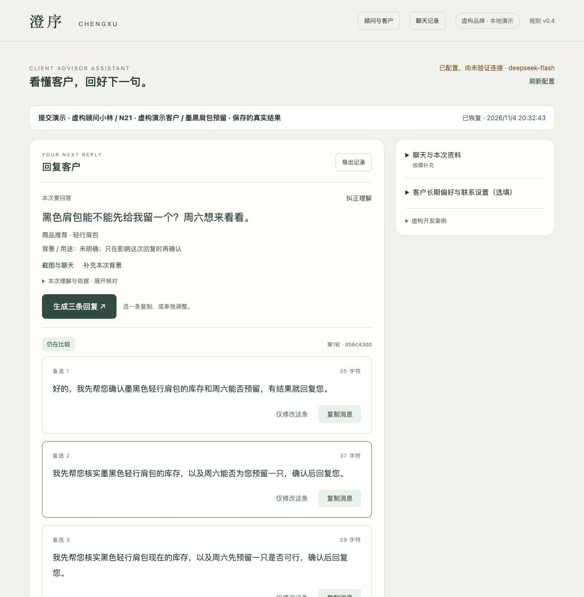
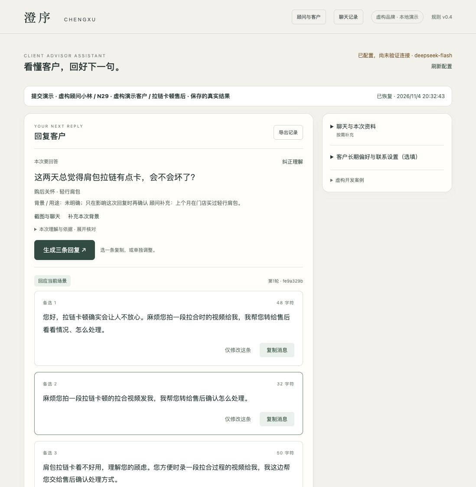
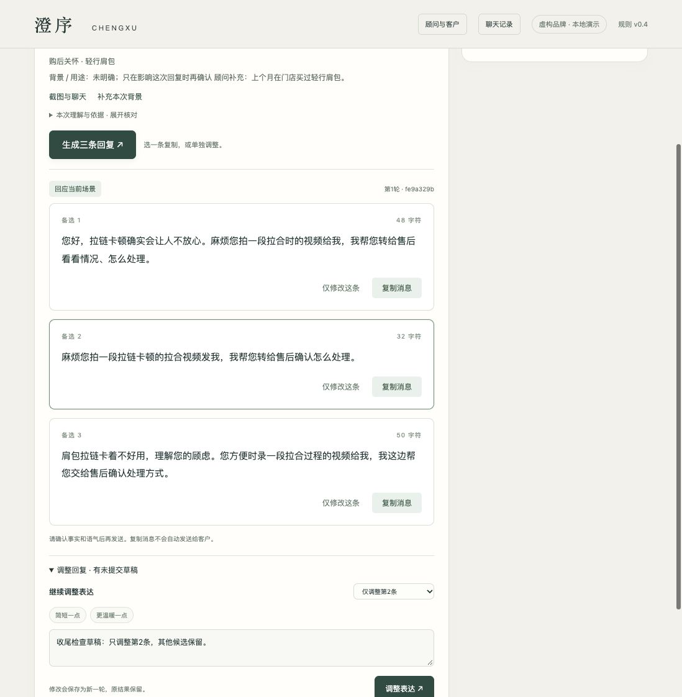
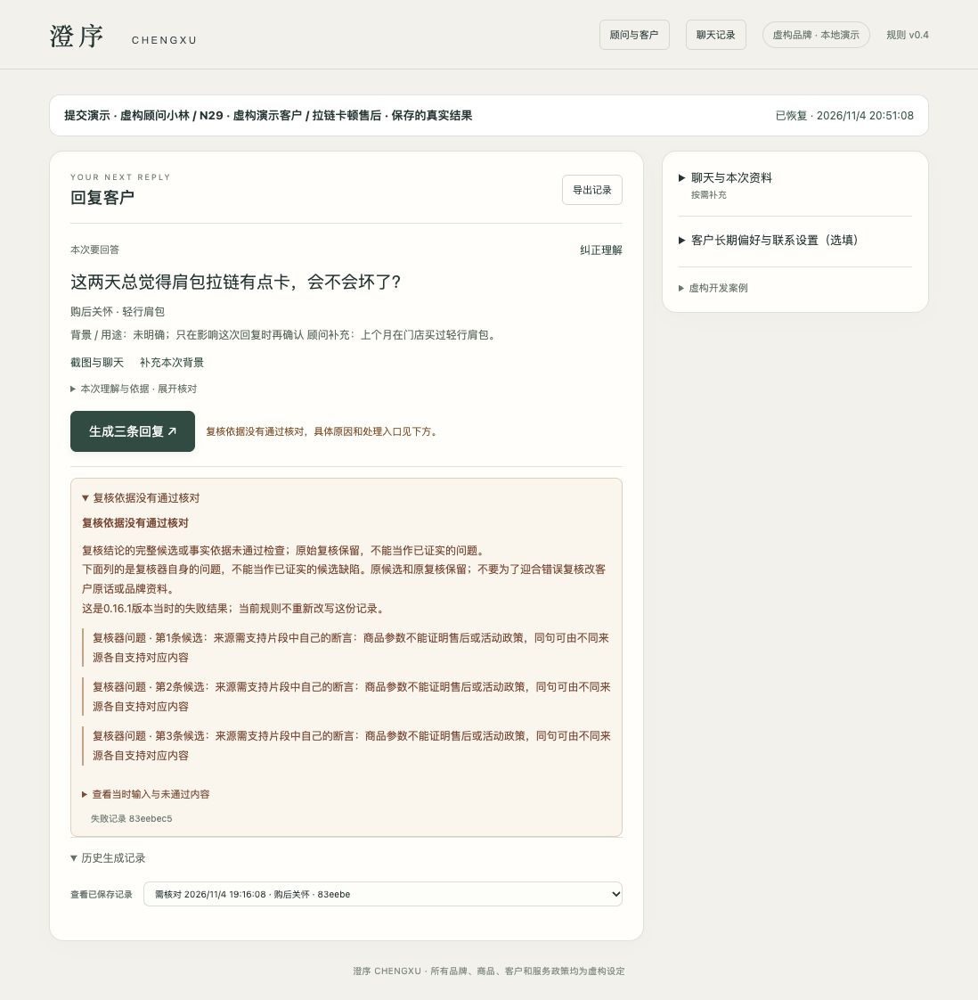
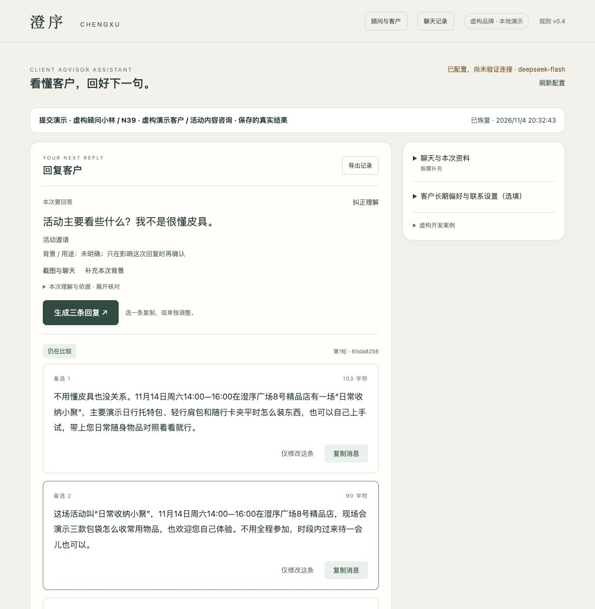

# D · 实际结果与证据边界

## 正式业务50的首轮结果

50组150条真实原文完整。首四app0.15.1，余46为0.15.2；94请求（50生成44复核），2441957 token，无自动重试。初始34组程序交付；0.15.3统一离线重验35组，仅N30因具体售后单来源权限修复改变状态。其余失败仍在表中。这不是事实正确率，也不是顾问愿发率。

[完整原文](C_50_ORIGINALS.html)逐案给原输入、三条原文、原模型复核、初始/重验状态、内容及编辑判断；不是只贴成功案例。原八列表的第二张表已分程序、事实、编辑及复核/程序问题。

## 发现了什么

程序会误拦：当前指代丢商品、比较宾语抢主语、总额当单价、当前售后单不被承认、混合来源要求每个来源证明整句。生成也会错：未核库存先保证、把沾水政策套成去渍、无据排障、内部说明和多余问题。复核会错：pass与issues矛盾、引用不当、忽略完整候选已有回答。因此三层分别记录，不将任一层自动当标准答案。

不同错误的业务影响不同。错价、折扣、错误售后承诺及内部信息泄露优先于略书面、重复时间、可选体验建议。轻微编辑意见允许polish，不强阻断；真实实质问题仍拦。[缺陷与对照](E_DEFECTS.html)。

## 本轮三项收尾

N21只改第二条，核库存及能否预留后回复；N29只改第二条，直接请拍卡顿视频并转售后。各生成/复核一次，共4请求108884 token，均pass且另两条原文相同。N39仅本地恢复请求唯一指定的source_protocol常量后重验通过，0新请求；供应商原响应仍不合规，原失败保留。后续结果不替换正式150条，也不重算一个更好看的50案通过率。

## 正常工具的本地走查

新增独立虚构顾问和N21/N29/N39会话，不修改原有客户。实际切换客户后，可恢复各自背景和有效结果；N29输入未提交修订草稿，离开、返回并刷新，草稿、背景、回复恢复。旧失败可打开且不可复制，再回有效结果。选择历史记录会暂时清空编辑框，但已保存草稿仍在库中、刷新可恢复，记为已知体验限制。

复制按钮实际点击并显示已复制；但自动化通道的虚拟剪贴板为空，原生粘贴报无数据，本机编辑器通道超时，另一浏览器通道不可用。没有将预期字符串手填作粘贴结果，也没有用toast宣称逐字核验成功。**复制后在本机文稿/微信逐字粘贴，仍需本人手动验一次。**

## 仍未证明的业务价值

上述是AI开发者模拟走查，非真实顾问研究。没有直接测量愿发率、真实顾问整体节时或与同资料通用模型的优势。模型等待之外还有上传、复核、阅读和修改成本，本次工具操作时长含自动化故障，不能当顾问工时。简单报价可能自己回更快；长上下文恢复、来源、限制及中断恢复是可观察工作流能力，是否让顾问更省事还待实用验证。

真实开发对话截图与产品截图分开：[缺口表](AI_CHAT_GAPS.html)。本页产品截图均实际采集，不是假聊天。

