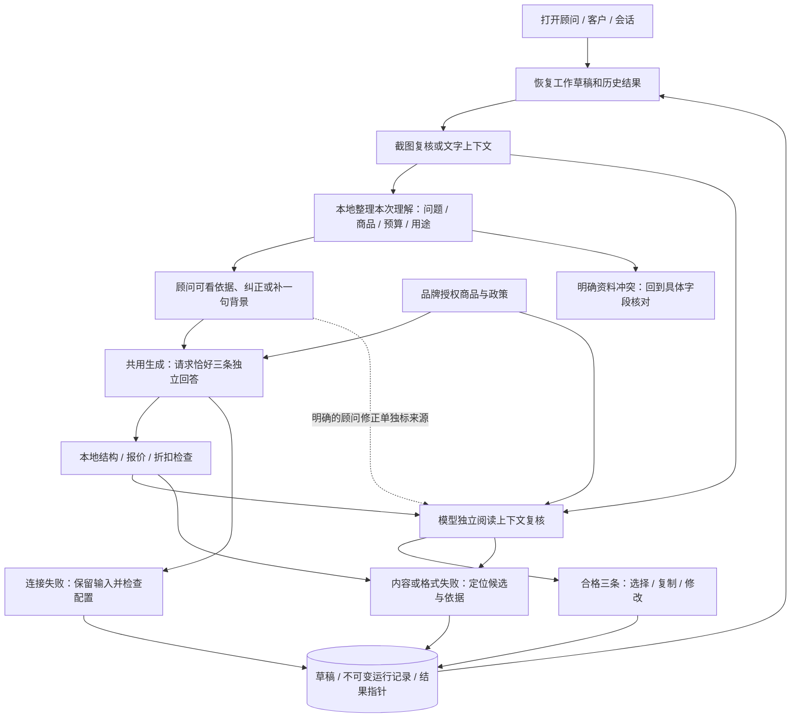
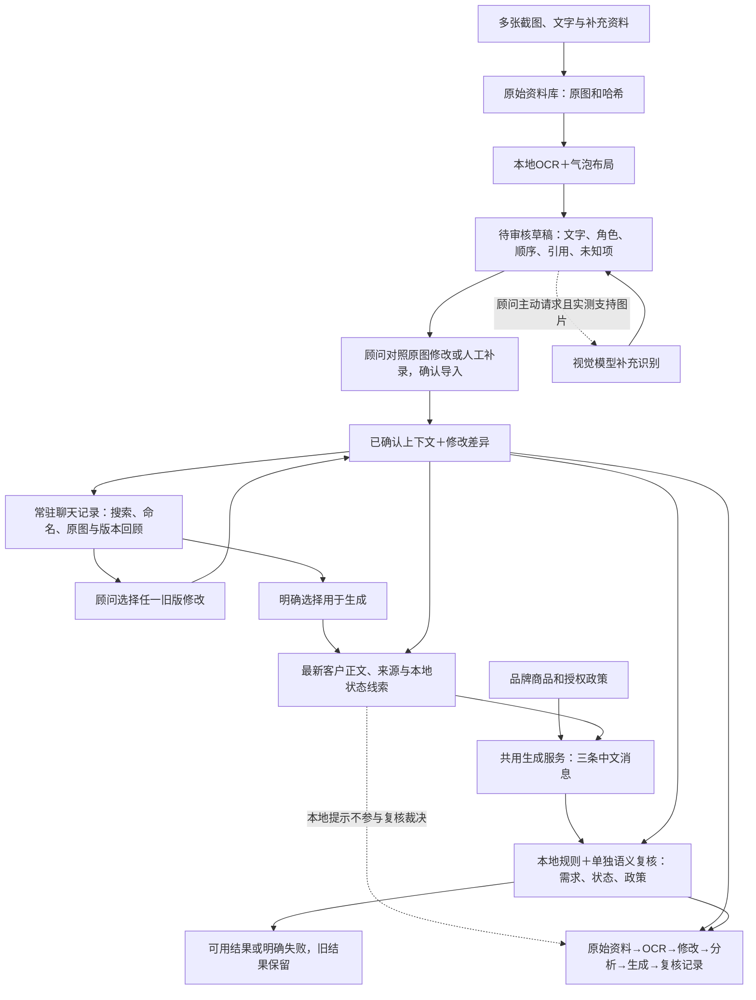
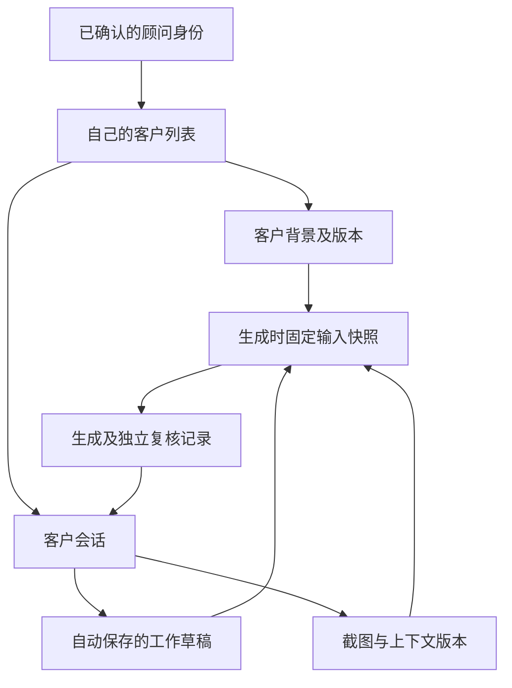
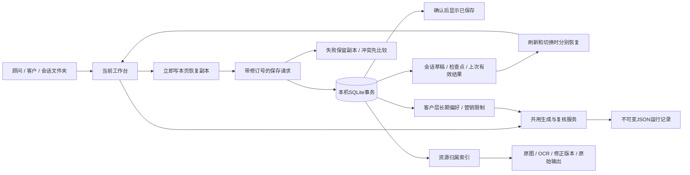

# 0.13.5：实际内容、说话人和当前客户资料

共用delivery检查不再用摘要开头词作证明，保留可对照的用途、偏好、问题及来源。指向未拿到材料的说明不当作材料本身，具体摘要也不因提到截图/语音而丢弃。实际未收件/听不清按引用范围、最近转述主体和事件日期核对，背景字段不是其中所有第一人称的所有者。已保存偏好参与推荐充分性，与当前缺正文的明确依赖分开；不能用长期偏好填补没导入的本次问题。

不改品牌/提示词/UI，不加字段或页面。0.13.4独立审核未通过保留，0.13.5只有开发本地修复验证，真实模型调用0；不冒称新的独立signoff。

---

# 0.13.4：按任务判断资料、区分两个受众

提交暂停。截图与明确选中的当前客户记录优先，顾问一句自然语言可补线下经历；长期偏好与当次预算分开。前置资料检查与候选/复核/历史交付守门共用delivery，网页禁按钮不是唯一边界。ready才是三条；needs_advisor零客户消息、有具体入口。数据缺口不能变成客户没发送或活动没定的现实断言；足够回答当前问题时不补全档案。

三条固定对象与顾问空消息数组在生成schema区分，本地校验状态和数量对应。没有三条候选时不请求候选复核；有三条时固定三份完整核对，复核可指出needs_advisor但不能把内部求助当客户文案通过。旧success/needs_info原记录不改写，动态交付守门不让它恢复复制；同会话明确选中资料按ID恢复，不按姓名借用。

本轮W02缺正文→补正文→原三条重验/真实复核→复制→切换/刷新已实走；售后拉链话题按谓词判断属性，故障与诊断分开。完整版本与限制见INPUT_RESPONSIBILITY.md。下文为历史设计，按其版本阅读。

---

# v0.12.2：有边界的语义与评估分层

联系判断使用消息发送日期、来源和旧聊背景，不以问号判咨询；没有日期时保留不确定，涉及营销限制才复用原背景入口确认，不加表单。暂停词表只是提示，不删模型的合法状态选项。

待核实只修饰对应命题；数值区分单价、预算、总额、差额及客户物品。来源校验核明显类型/权限、候选归属和结论矛盾；词表未命中不证明引用无关。参数比较不证明定价原因，检查器也不宣称证明全部中文。

生成、程序检查和独立复核各自可能错，正式评估分层记录。冻结v0.12.0首轮50案结果31组交付，后续代码/两案真实验证/本地原响应重验分别留版本，原150条不替换。详见FORMAL_EVALUATION.md；页面仅补必要确认定位，截图流程保持。

---

# v0.11.6 信息归属与多来源复核

生成和复核共用原品牌/商品索引及WRITING_RULES。statement_scope先分对象、数值角色、疑问/转述/待核实/否定与动作时态；预算、竞品、客户物品和商品参数不互相授权。当前话题保留最新需求、拒绝范围和明确的整段历史时间，不能让旧选择或局部关键词强行覆盖新问题。

复核改用sources-v3：政策、商品、活动、顾问背景、任务、长期联系偏好、聊天和补充文件分别索引；模型选source_id及candidate_span_id，程序从保存快照按精确位置展开resolved_review，原模型输出另外保留。来源ID存在不是所有语义都正确，继续检查候选所属、同商品事实、全句漏答、虚构完成与当前状态依据。状态标签不决定事实：other/comparing可有重叠，拒绝/暂缓须有当前来源，不把“购意未知”当暂停。

严格结构定义恰好三个必填候选，生成和复核都校验实际发送的schema；不截取、不补格式、不自动降级或重试。内部提醒与发送安排留顾问侧，祝福/售后/活动按场景，不硬套商品介绍模板。网页和批量检查继续共用engine；本轮没有页面或截图流程改造。

184项本地检查和原十四案多轮真实闭环：13组安全三条、1个正确营销停止。最后新增“还是”不是通用问句标志的本地修复，正反对照及最终整组重验通过。详细取舍、实际版本及限制见[十四案验收](CHALLENGE_REPAIR.md)。

---

# v0.9.2 生成与评审使用同一写作依据

2026-11-02。应用0.9.2、生成0.7.2、复核review-0.6.2。用户指出旧组三条同样退回试背、审核腔偏重；此前v0.8.0对语气与选择价值的判断不继续作为用户认可。新组`6c5ee5d1`事实/结构及复核检查通过，**自然程度待用户试读**，原文与完整取舍见[WRITING_REVIEW.md](WRITING_REVIEW.md)。156项本地方法通过；本轮同一案例真实生成4次/复核4次，共102,264 token，无自动重试/50例。正常后台<http://127.0.0.1:8765/>按用户要求保持运行。下文保留此前阶段的历史判断，不代表当前写作结论。

---

# 澄序话术助手：产品与架构 v0.8.0

日期：2026-11-02。品牌v0.2/商品索引不变；生成0.6.0、复核review-0.5.0、本地检查0.4.0、复核证据检查0.2.0。148项本地检查及同一案例真实生成/复核、页面复制/恢复通过；原失败与源代码版本保留。见FINAL_ACCEPTANCE.md。

## v0.8.0闭合结果与证据链

保持页面/截图/客户输入不变。一般/普通/同类商品比较缺基准时拦截；单款真实数字不能授权概括比较。未知属性仅在当前问题需要时才说明，避免把内部缺项转嫁给客户。三条按快答、已知使用情境判断、顾问协助的行动侧重设计，每条仍独立答题，不靠额外问题或新卖点分化。

复核字段覆盖按真实源值及原子事实核对，不按字段名一一重复：同商品capacity明确写可放A4即可覆盖a4_fit；不同商品/极性或假值无效。明确参数也可由程序直接按目录证明，evidence_coverage逐条记录模型引用或本地方法；错误复核引用仍阻断，不修改其原始输出。完整候选、客户引用和未知正反检查继续保留。

新目的记录在单例账本：先本地回归，再真实生成/复核各一次；页面完成实际复制粘贴和保存恢复后才验收通过。通过即停止，不继续生成或扩大场景。资料/输入/原响应/提示词/依据/代码哈希/评判和页面证据留档。旧失败和旧账本不重置。

## v0.7.0生成与复核的共同依据

product_evidence.json索引原品牌资料的明确字段与未知项，不新增商品设定；生成、确定性检查和独立复核共用，记录完整快照、来源和哈希。unknown既非true也非false，P01未提供的属性不能从P02迁移。目录唯一简称用于定位对象，无法定位时不按参数反猜。精简索引传给模型，原始品牌政策仍随请求提供。

DeepSeek非思考请求使用beta strict函数返回；output_contract.py将三个候选定义为三个必填字段，并对复核固定三个完整核对字段。远端结构已在后续单例真实生成/复核各一次中获接受；内容质量未通过，不能据一个接口成功宣称可靠性合格。本地仍拒绝多/少/额外/重复键、多调用、附带说明和非正常结束；逐字映射回原网页数组，不截取、不重写、不降级、不自动重试。其他兼容接口保留明确标记的JSON本地校验。

review_validation.py核对复核依据：完整候选原文、客户正文引用、同商品字段及值、有限事实断言和漏答指控。错误复核存invalid_review和validation_errors，不将其理由当事实，也不忽略后转成功。复核传输/格式失败和语义来源无效都保留原始响应。当前语义核对有限，不宣称机器已证明所有事实和表达正确；实际三条可靠性与选择价值仍需真实单例验证。详细取舍、原四条重评及接口来源见RELIABILITY.md。

## v0.6.1最小改动：从确认聊天到回复

保留顾问→客户→会话和截图整理，不新建档案流程。在原生成按钮前显示“这次的理解”：这次要回答、当前商品、本次预算、已知用途。来源可展开并返回确认消息或背景；原话、前文推定、未明确、顾问修正分开显示。正常情况不再加一次必点确认，不重新填已有商品和预算；只补截图外背景。

`understanding.py`是有限的本地规则摘要，通过POST /api/understanding和生成前同一函数使用，不增加模型调用。预算仅来自明确预算表述，不把报价/竞品价格当预算；较新的明确预算可更新较旧值，资料间冲突单独提示。未知预算本身不阻止一般商品答疑。商品可以从前文唯一话题推定，但明确标注；声音占位、歧义或多商品不能凑成确定事实。复杂指代和自由表达仍可能识别不全，顾问可纠正。

摘要不修改原聊天，不写成客户长期状态。修正作为advisor_context_corrections带来源哈希保存，资料变更后须重新核对，避免旧修正覆盖新聊天。生成接收摘要作为可出错的提示；复核不接收该摘要或生成器状态作为证据，独立看原上下文，明确的顾问修正另作带来源资料。品牌政策仍只由品牌资料授权。

`failure_guidance.py`将错误分为资料冲突、输出/政策、连接/配置、复核传输及诊断记录，给具体候选、原文、依据和入口；不把内容冲突都导向重试。历史读取只派生展示字段，原JSON下载不变。自动重试继续禁用；仅重做复核的产品入口暂未实现，不暗中重新生成。

三条需要各自完整回答核心问题，有值得选的侧重，无需每条强行追问。恰好三条是硬门槛；本次真实模型返回四条，其中第4条是跨候选自我纠错，整组未采用。诊断复核虽然block，其品牌解释也有事实错误，不能将“第二个模型说的”当作授权或正确性证明。下一步先补商品字段与未知值、复核事实引用和三条选择价值，暂不重做页面。实际结果与未完成环节见VERIFICATION.md和UX_REVIEW.md。

## 本轮确定的使用情境

第一版截图入口面向顾问自己微信账号的一对一聊天截屏。左侧收到的气泡先归为客户，右侧发出的气泡先归为顾问，结果始终是待审核草稿。截图内的引用框、转发内容和另嵌的聊天截图属于消息内容，不自动作为当前会话的新消息或身份依据。群聊、拼接转发页等不在首版自动判断范围。

用户选择OCR＋布局为主，视觉模型按需补充。Mac本地优先使用Apple Vision OCR，提供文字、位置框和置信度，不把OCR结果当作业务事实或品牌授权。该本地适配器不按次收取云API费；跨平台OCR适配后续再接。

## 截图到上下文的流程

1. **放入资料。**粘贴、拖放或选择多张截图。保留每张原图、哈希和上传顺序；可以调整截图顺序。保留客户资料、订单、活动资料、顾问一句背景及普通文字聊天入口。生日问候可没有聊天记录。
2. **识别草稿。**OCR提取文字框，布局归入气泡；按画面自上而下排列，跨图只在有充分重叠证据时合并。左右用于默认角色假设，不跳过顾问审核。无法确定的顺序或角色高亮。
3. **对照复核。**原图保持原样，旁边用左客户、右顾问的草稿气泡展示。每条有发送者下拉框，改角色后草稿立即换边。可改正文、引用文字、消息类型，调整顺序或排除重复项。点来源可回看对应截图位置。原图有漏掉的消息时，可补录并指定角色、原图和位置说明，再调回原图顺序。
4. **确认并导入。**顾问检查后点一次确认；没有问题时无需逐条点击。有关键疑点时先纠正。未确认草稿不得进入生成；确认写成新记录，保留原识别及逐字段修改差异。
5. **整理需求线索。**将确认后的消息、补充背景、最新客户正文与局部状态证据分开提供给生成服务；语义复核另行判断当前需求和状态。语音仅表示存在未转写语音，不代表已经听过；引用单独存放，不拿引用中的旧拒绝覆盖当前问题。
6. **生成与检查。**按品牌v0.2生成三条，再做确定性规则检查与单独的上下文/政策复核。本地状态仅提示，复核不接收此提示或生成器状态，独立阅读完整消息、否定范围、商品对象和新问题。生成与复核不一致才阻断状态通过；只有本地提示不同时记录差异并提醒顾问，不强行覆盖语义。客户声称曾获优惠、旧聊天中的报价或上传订单都不能修改品牌授权政策。
7. **继续调整。**沿用同一份已确认上下文；“更温暖”只改表达，不改变客户已拒绝的事实。改背景或换上下文时生成新的一组。失败保留上一组有效结果和本次原始响应。

## 随时打开聊天记录

顶部“顾问与客户”选择工作文件夹；“聊天记录”浏览当前会话已归档的截图，不依赖再次上传。列表按聊天归档，支持命名、搜索历史版本正文与引用，默认打开最新确认版本；原始草稿与所有确认版本均可切换查看。历史不限制在最近20份。旧版已有的截图记录自动按原始草稿归组，不改写原文件。

“对照原图并修改”复用原图/气泡复核窗口。改角色即时换边，可改文字、引用、顺序和纳入状态；保存生成新的context_id，parent_context_id仍指原始OCR，previous_context_id指本次选作基准的版本，changes记录相对此基准的差异。从旧版修改形成新版本，原来的后续版本仍保留。语音未知等约束同首次确认。

人工补录使用独立消息编号，origin=manual，标记为“人工补录”。保存时由服务写入首次补录的context_id、基准版本和补录时间；来源图片必须属于原始截图组，位置说明必填，不伪造OCR框或置信度。新增动作与后续文字、角色、顺序、来源说明改动分别留痕，补录时间不代表聊天发送时间。旧版已保存的补录必须保留或排除，不能悄悄删除；未保存的新补录可移除。即使OCR一条也没识别，也能对照原图补录后确认。

已有语音占位不能改成已听正文，人工补录的语音同样只允许未转写占位。补录内容是否与原图一致依赖顾问对照，系统只校验来源属于本组和资料格式；顾问一句背景仍通过背景入口提供，不冒充原图消息。确认后补录正文及来源一起传给生成和复核，但不能授权优惠或商品政策。

浏览和编辑历史与工作台分开。取消不保存，保存后也不会暗中替换当前生成输入；只有点击“用于生成”才载入选定确认版，保留当前会话背景、补充文字、商品选择与结果。顾问/客户切换由文件夹入口负责，不能靠清空字段代替归属隔离。旧生成记录仍引用当时的context_id，不会随历史修正改变。

第一版记录库涵盖截图导入的聊天；纯文字生成记录仍从右侧历史恢复。同一会话可归档多份截图组；自动拼接多次导入、跨设备同步和记录删除暂不实现。

## 关键边界

- 截图看不到的名字、时间、文字、语音内容不补造。空白或低置信度保留未知，不猜成完整句子。
- 正文、引用、语音、系统时间、媒体占位分别保存；引用没有独立发送时间时不伪造时间。
- 截图默认来自顾问本人账号。来源或布局与这一情境冲突时提示复核，不把嵌在气泡内的截图当作主会话。
- 客户状态必须引用确认消息的编号和原文；本地线索只记录否定、商品范围和新问题，不作最终语义裁决。“我不是不想买”不能截成拒绝；“肩包不考虑了，但想了解托特包”不等于拒绝整个会话。售后新问题也不自动代表想买。
- 商品现价、折扣、售后只由品牌资料授权。订单实付、竞品价格、客户预算分别标注来源和含义，不能混成当前标价。
- 本地规则检查结构、错价、折扣承诺及否定句；复杂语义仍需模型复核及顾问最终判断。单独复核调用不是正确性的保证。

## 架构

## 技术与追溯

保留Python本地服务与原生网页。增加图片读取、布局处理和本地OCR适配器；前端不保存key。视觉补充只接受本地配置的模型，先发送含随机可见标记的测试图片，核对实际返回；接口兼容不等于支持图片。选型与价格见`MODEL_OPTIONS.md`。

网页和开发脚本共用截图识别、确认导入、需求分析、生成和检查函数。数据分开保存：`data/assets/`原始资料，`data/contexts/`草稿与确认版本，`data/chats/`聊天名称，`data/runs/`生成与复核记录，`data/capabilities/`图片能力验证。新增data/workspace.sqlite3保存顾问/客户/会话归属、工作草稿及检查点、长期偏好版本、联系限制、结果指针；原图及JSON原件仍保留。每次请求核对本机选择的顾问与会话归属，列表、单条读取、原图和导出一致；演示选择并非真实鉴权。各阶段使用UUID和内容哈希关联。原始资料不覆盖，人工改动不冒充OCR原文，生成失败也保留原始草稿与检查原因。导出包含所选版本的来源链和哈希。

## 本轮与后续

此前已接入一对一截屏到可复核上下文，修复已知校验缺陷，并使用少量有挑战性的虚构截图检查OCR、角色和顺序。真实生成及视觉补充需要本地配置；未配置时如实保留未完成状态，不以替身算通过。

用户后来配置key并授权单例验证。已在DeepSeek deepseek-flash上用一个比较案例完成两次生成＋独立复核，共4次请求。新增每条候选独立完整回应最新问题的要求，生成提示词升为0.2.1、复核提示词为review-0.1.1；过程和限制见VERIFICATION.md。没有运行正式50例，也没有调用图片能力探测或视觉补充。

上段为v0.3.0历史。v0.4.0将生成提示词升为0.3.0、复核升为review-0.2.0，并完成51项本地检查。后续已执行换商品单例：先真实生成一次被价格简称绑定误拦，v0.4.1修复后复用原输出补一次真实复核通过，该例累计生成＋复核2次请求，没有自动重试。v0.4.1当时57项自动检查通过，语气与候选差异仍待改进；详见VERIFICATION.md及UX_REVIEW.md。

后续在真实模型少量案例通过后再做正式50例；再考虑群聊、复杂转发页、跨平台OCR和语音转写。语音转写需要真实音频，不能从语音条截图推断。

## 顾问、客户与会话归属（本机已实施）

用户进一步要求按顾问和客户组织资料：顾问拥有自己的客户，客户有背景和多个会话，会话下保存截图、上下文版本、工作草稿和生成记录。会话ID与OCR草稿ID分开，避免同一客户每次放截图都变成孤立记录。

本地最小方案用SQLite保存归属、草稿与版本索引，现有原图及JSON原件保留；生产登录和请求授权在后端处理，演示顾问下拉框不能当作权限。客户长期偏好、当次预算、对某商品的意向不合并成一个状态。迁移先在副本验证，旧ID/哈希保留，无法归属的记录人工归档。详见DATA_DESIGN.md；体验优先级见UX_REVIEW.md。本轮已落地本机SQLite并在独立副本验证归档。原始旧资料仍待用户确认归属，没有按名字推断或改写旧文件。生产登录、跨设备同步和客户转交仍未实现。

## v0.5.0保存与恢复

保存500毫秒防抖，输入同时写浏览器恢复副本；切换前等待事务回执。草稿包括截图/附件顺序、原草稿ID、确认版本ID、尚未确认的消息编辑、本次背景和修改要求。恢复草稿与恢复结果分开，不能用旧生成输入覆盖刚补的备注。预算或客户规则变化时，旧结果标成历史并暂停复制，避免把旧“在预算内”直接发出去。

保存采用修订号和请求编号：旧页不能覆盖新页；回执丢失可按相同编号确认，若其后又有修改则转冲突处理。事务失败不写半份偏好和草稿。每次生成保留客户层快照、检查点修订号、输入、原响应、模型与版本。异步处理期间暂不切换客户，后端仍把结果固定归属到发起会话。

明确拒收营销要求只看客户正文或顾问明确设置，引用、顾问消息、未转写语音不写入。联系限制一经记录跨会话保留；本次预算和单款拒绝不提升为客户长期事实。主动生日/唤回/活动在模型调用前阻止，主动咨询/售后由带联系限制的同一生成和复核逻辑处理；后者本轮仅验证接口流程，尚未做真实模型质量回归。

## v0.5.1连续截图的衔接

建议同一段聊天的下一张保留上一张末尾1—3条完整消息，尽量包含具体内容。重叠既可一条，也可多条；不是只查一个“公共G”。例：`ABCDEFG`与`EFGHIJ`应得到`ABCDEFGHIJ`，E/F/G分别保留两张原图的位置来源。

1. 各张先独立做本机OCR和气泡归类，保留原图、原OCR、原消息顺序与上传顺序。
2. 比较完整消息的角色、正文及引用。只归一空白/换行和Unicode全半角；报价不同、引用不同或角色不同不自动合并。未知角色、媒体、未识别占位和语音不当作文字锚点。
3. 找连续重叠及完整包含的关系。单条需有足够具体的文字；多条需连续匹配并有一定信息量。“好的/谢谢”一类短句或可对应多个位置的重复片段不会单独促成自动合并。
4. 用一致的相对位置关系组织每张图；关系唯一且无冲突时推定顺序，重叠部分只留一条正文，并保留各次出现的原文、来源图及位置。不是全局按文字去重，同图或不重叠位置的重复发言保留。
5. 无证据的组间顺序不猜；关系冲突保留原页顺序与全部消息。页面提示后由顾问调整消息顺序、取消重复项或补录。
6. 默认自动整理，正常情况只需一次复核确认。可关闭自动整理后重新识别，按当前图片顺序逐图保留；这个选择和消息草稿一起保存。查看来源图不算改动，不会强迫多存一个确认版本。

`screenshot_stitch.py`与本机OCR解耦，记录算法版本、代码哈希、原上传顺序、推定顺序、对应片段、冲突及每次出现。`pages[].draft_messages`保持原始识别不变；确认与生成通过原有同一套逻辑，正式生成只读取已确认的合并正文一次。这里只是截图衔接假设，无法证明两条相同的长话一定发生在同一时刻，仍由顾问对照确认。

图中被裁断或OCR错字造成匹配不一致时先保留，不用模糊字符串替换掩盖差别，也不补出图外内容。视觉补充仍为原有按需独立入口，本轮未调整或云测其跨图能力。
